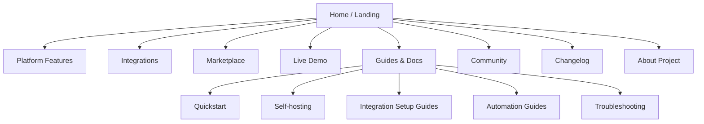

# Homenavi Website Product Plan

## Objective
Build a real product website for Homenavi at `www.homenavi.org` that feels like the public face of the platform rather than a repackaged app shell.

The site should:
- Reuse most of the current Homenavi visual language.
- Introduce a strong landing page with clear product positioning.
- Offer a prominent entry point to the live demo instance.
- Showcase integrations and marketplace content.
- Provide guides, onboarding, and support content for real users.
- Give Homenavi a credible product narrative for visitors who are not yet ready to self-host.

---

## Current Starting Point

The target repo `/home/adam/Projects/homenavi-website` is effectively empty today.

That means this project should start as a clean website build, but it should not invent a new visual identity. The current app already provides strong inputs that should be reused:

- color tokens and gradients from `frontend/src/colors.css`
- glass-card and pill treatment from the main app
- integration card patterns from the current marketplace/admin UI
- hero-card treatment from the About page
- product feature language from the main `README.md`

---

## Product Positioning

The website should answer three visitor questions quickly:

1. What is Homenavi?
2. Why would I use it instead of a closed smart-home stack?
3. How do I try it right now?

Recommended positioning:
- Open smart-home platform
- Integration-first architecture
- Realtime dashboard, automation, and device inventory in one system
- Self-hostable, but approachable
- Extensible for both users and integration developers

Tone:
- technical but welcoming
- product-focused, not academic
- confident without overselling maturity

---

## Design Direction

### Visual reuse from the current app
Preserve these brand anchors:
- deep slate backgrounds
- emerald primary accent
- translucent glass surfaces
- rounded cards and pill navigation
- bold, clean product headings

### What should change for the website
The website needs more breathing room and stronger editorial layout than the application shell.

Recommended website-specific adjustments:
- larger hero typography
- wider content rhythm and section spacing
- more screenshot-led storytelling
- cleaner content columns for docs and guides
- more contrast between marketing content and app UI screenshots

### Design rule
The website should look like it belongs to the same product family as the app, but it should not feel like the dashboard copied into a homepage.

---

## Site Map

---

## Core Pages

### 1. Home / landing page
Purpose:
- establish the product story
- show the product visually
- route visitors to the right next step

Recommended sections:
- Hero with headline, short subcopy, and two primary CTAs
- Screenshot or short product montage
- Core value strip: devices, automations, dashboards, integrations
- Architecture/value section for power users
- Marketplace spotlight section
- Demo teaser section
- Quickstart section for self-hosters
- Social proof or project trust signals
- Footer with docs, GitHub, Discord, demo, marketplace

Primary CTAs:
- `Try live demo`
- `Self-host Homenavi`

Secondary CTAs:
- `Browse integrations`
- `Read the guides`

### 2. Features page
Focus on the major product pillars:
- realtime devices
- dashboards and widgets
- inventory and map
- automation engine
- integrations runtime
- observability and deployment path

This should use screenshots and short diagrams rather than only text.

### 3. Integrations page
Purpose:
- explain how integrations work
- show available categories and examples
- route users to install docs and marketplace entries

Recommended sections:
- verified integrations
- community integrations
- integration developer path
- runtime modes and deployment expectations

### 4. Marketplace page
Purpose:
- expose the Homenavi integration catalog in a product-friendly way
- support search/filter/badges
- link to detailed integration pages

Recommended behavior:
- fetch or prebuild from marketplace API metadata
- surface verified, featured, and trending integrations
- show version, publisher, capabilities, and screenshots
- provide install docs link rather than in-browser install for the product site

### 5. Demo page
Purpose:
- set expectations for the live demo
- explain what is interactive and what is read-only
- provide direct entry to `demo.homenavi.org`

Recommended sections:
- live demo CTA block
- what you can explore
- what is intentionally disabled
- note about temporary demo sessions
- fallback path if the demo is temporarily offline

### 6. Guides and docs
Purpose:
- support users after discovery
- reduce GitHub README overload
- turn product interest into successful usage

Recommended guide structure:
- Quickstart
- Local Docker setup
- Kubernetes install
- Device and map setup
- Dashboard customization
- Automation basics
- Integrations install and update flow
- Troubleshooting and FAQ

### 7. Community / about
Purpose:
- explain project background
- link to GitHub, issues, Discord, and roadmap
- humanize the product without turning the page into a personal blog

### 8. Changelog
Purpose:
- show project momentum
- surface releases and notable features
- improve trust for evaluators

---

## Landing Page Content Plan

### Hero
Draft direction:
- Headline: `Your smart home, on your terms.`
- Supporting copy: `Homenavi combines realtime device control, dashboards, automation, and an integration marketplace in one self-hostable platform.`

Hero CTAs:
- `Try the live demo`
- `View deployment guide`

Hero media:
- main dashboard screenshot
- optional subtle animated highlight overlays

### Value blocks
Recommended four-block structure:
- Realtime control
- Visual dashboards
- Automation workflows
- Integration marketplace

### Proof section
Use concise facts drawn from the current platform:
- microservice architecture
- MQTT/HDP realtime plane
- Docker and Kubernetes deployment paths
- integration runtime with marketplace model

### Demo strip
The landing page should include a clear callout for the public demo:
- direct demo link
- note that no setup is required
- note that some actions are disabled in the demo

### Self-hosting strip
For users ready to install:
- Docker Compose quickstart
- Helm/Kubernetes path
- links to more detailed guides

---

## Design System Reuse Plan

Use the current app as the starting source of truth.

### Reuse immediately
- color tokens from `frontend/src/colors.css`
- card surfaces inspired by `GlassCard`
- pill navigation inspired by `GlassPill`
- section headers inspired by `PageHeader`
- integration visual treatment inspired by `IntegrationCard`

### Adapt for the website
- create page-width containers and a spacing scale suited to editorial layouts
- build a marketing hero variant of the glass card
- define a screenshot frame component
- define a docs article layout component

### Suggested rule for reuse
Copy the visual primitives first. Only extract a shared package later if both repos start changing those primitives in parallel often enough to justify it.

---

## Technical Architecture Recommendation

Use a framework optimized for marketing, docs, and SEO rather than duplicating the application shell.

Recommended stack:
- Next.js with App Router
- React
- TypeScript
- MDX for guides and long-form docs
- static generation for most marketing pages
- server-side or build-time fetches for marketplace content

Why this fits:
- SEO matters for the public website
- content pages and guides benefit from MDX
- screenshot-heavy landing pages benefit from image optimization
- React makes reuse of component ideas from the main app straightforward

If strict stack reuse matters more than SEO convenience, Vite + React is still viable, but the default recommendation for the website is Next.js.

---

## Data And Content Sources

### Content managed in the website repo
- landing page copy
- feature descriptions
- guides and FAQs
- community/about content
- changelog summaries

### Content sourced from existing Homenavi systems
- integration catalog metadata from marketplace APIs
- screenshots from the main app
- release/version metadata from GitHub releases or repo tags
- selected architecture facts from the main repo docs

### Synchronization rule
Do not make the product website depend on the application being online for basic rendering. Prefer build-time fetch and cache for marketplace content, with graceful fallback if the API is unavailable.

---

## Demo Integration On The Website

The demo link should be treated as a primary product action, not buried in docs.

Recommended placements:
- hero CTA on the home page
- persistent top-nav link
- dedicated demo page
- footer CTA

Recommended behavior:
- if the demo is healthy, route directly to `demo.homenavi.org`
- if degraded, show a lightweight status note and alternative screenshot/video content

Recommended copy constraints:
- explain that the demo is temporary
- explain that some sensitive actions are intentionally disabled
- keep the promise clear: visitors can explore without setup

---

## Guides And User Support Plan

The website should become the user-facing home for practical guidance, not just a marketing shell.

### Minimum guide set
- Getting started
- Install with Docker Compose
- Install with Helm
- Add and manage devices
- Configure dashboards
- Build automations
- Browse and install integrations
- Troubleshooting
- FAQ

### Documentation style
- short pages with real screenshots
- explicit prerequisites
- clear command blocks
- cross-links between concept and task pages

### Support surfaces
- searchable guides index
- version-aware docs if releases stabilize further
- community links to GitHub and Discord

---

## Marketplace And Integration Features For The Site

This should be more than a static list.

Recommended marketplace experience:
- searchable grid of integrations
- featured and verified badges
- publisher details
- screenshots and descriptions
- capability tags such as widgets, automations, device support, setup UI
- direct links to install/setup docs

Recommended integration detail page structure:
- overview
- screenshots
- capabilities
- requirements
- install path
- setup path
- troubleshooting links

This gives the website real product depth without mixing it up with the app's in-cluster installation workflow.

---

## Delivery Plan

### Phase 1: Foundation
- initialize the website project
- import the current visual tokens and core UI primitives
- build layout, nav, footer, and content scaffolding

### Phase 2: Marketing surface
- build landing page
- add features page
- add demo page and CTA routing

### Phase 3: Content and support
- add guides/docs section with MDX
- migrate core user-facing setup content from the main repo docs into website-friendly guides

### Phase 4: Marketplace experience
- add marketplace listing and integration detail pages
- wire build-time data fetching and caching

### Phase 5: Polish and launch
- responsive QA
- SEO metadata
- analytics
- accessibility pass
- deploy to `www.homenavi.org`

---

## Success Criteria

- Visitors understand what Homenavi is within one screen.
- The landing page presents both a product story and a working next step.
- The live demo is easy to find and clearly explained.
- Integrations and marketplace content feel like a first-class part of the product.
- Users can find practical setup guides without being dropped straight into raw repo docs.
- The visual language feels recognizably Homenavi, not like a separate product.

---

## Recommendation

Build the website as a proper product surface with three equal priorities:
- product narrative
- live demo entry
- practical user guidance

The current app already contains the visual DNA needed to make this site feel coherent. The website should reuse that DNA, widen it into a more editorial layout, and turn Homenavi from a repo-first project into a product people can understand, try, and adopt.